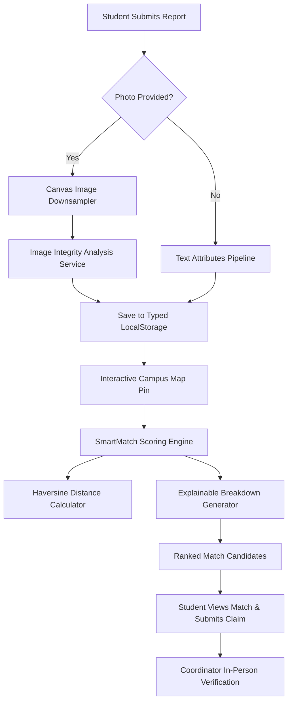

# How Findit Works — Architecture & System Design

This document details the architecture, matching mathematics, and data flows of **Findit** for Kakatiya Institute of Technology & Science (KITSW), Warangal.

---

## 1. High-Level Architecture Flow

---

## 2. Interactive Campus Map & Geographic Proximity

Findit embeds **Leaflet + OpenStreetMap** centered on KITSW:
- **Center**: Latitude `18.0522`, Longitude `79.5361`.
- **Custom SVG Pin**: High-contrast forest-green pin (`#174B3A`) with ivory center.
- **Coordinate Extraction**: Clicking anywhere on the map or dragging the pin updates `(latitude, longitude)` and automatically determines the nearest campus block using the Haversine distance formula:

$$d = 2R \arcsin\left(\sqrt{\sin^2\left(\frac{\Delta\phi}{2}\right) + \cos(\phi_1)\cos(\phi_2)\sin^2\left(\frac{\Delta\lambda}{2}\right)}\right)$$

Where $R = 6,371,000$ meters.

### Distance Scoring Tiers in SmartMatch:
- $\le 60\text{ meters}$: Full score (15 pts) — same block or perimeter.
- $\le 180\text{ meters}$: 12 pts — adjacent buildings.
- $\le 350\text{ meters}$: 8 pts — common walking quad.
- $> 350\text{ meters}$: 3 pts — different ends of campus.

---

## 3. The 5-Factor SmartMatch Formula

| Factor | Weight | Scoring Logic |
|---|---|---|
| **Description & Features** | **35%** | Jaccard-style token overlap over cleaned keywords (excluding stop words). |
| **Category & Title** | **25%** | 15 pts for exact category match + up to 10 pts for title phrase overlap. |
| **Color Agreement** | **15%** | 15 pts for exact color match, 10 pts for partial tone match, 8 pts neutral if unspecified. |
| **Location & Proximity** | **15%** | Haversine distance between coordinates or block name similarity. |
| **Date Proximity** | **10%** | Same day: 10 pts; $\le 24$h: 9 pts; $\le 3$ days: 7 pts; $\le 7$ days: 4 pts. |

**Total Score**: Sum of all 5 factors scaled from 0 to 100%.

### Confidence Tiers:
- **Strong Candidate**: Score $\ge 75\%$
- **Moderate Candidate**: Score $50\% - 74\%$
- **Weak / Exploratory**: Score $35\% - 49\%$
